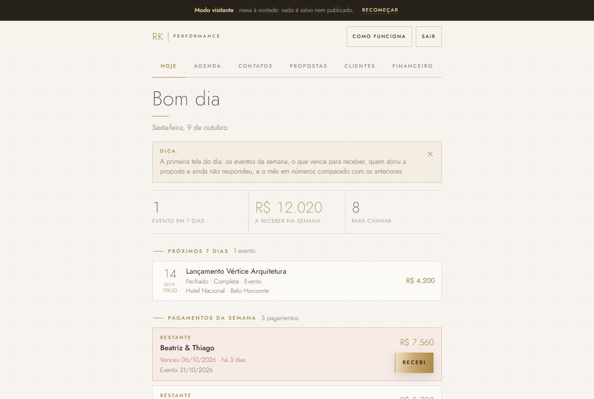

# Painel de propostas

Sistema para quem vende serviço por proposta (fotógrafo, DJ, buffet, cerimonial, decoração, consultoria) montar propostas bonitas, mandar por link no WhatsApp e acompanhar agenda, contatos e dinheiro a receber num lugar só.

**Teste agora:** https://painel.rkperformance.com.br → **Entrar como visitante**. Dá pra mexer em tudo; nada é salvo.
Proposta pronta de exemplo: https://painel.rkperformance.com.br/proposta/?p=exemplo

| Painel (computador) | Agenda do mês |
|---|---|
|  |  |

| Proposta que o cliente recebe | Financeiro no celular |
|---|---|
|  |  |

## O que dá pra fazer

- **Hoje:** os eventos da semana, o que vence para receber, quem abriu a proposta e ainda não respondeu, e o mês em números.
- **Agenda:** o mês de relance, com eventos fechados, propostas esperando resposta e datas livres.
- **Propostas:** criar, duplicar, publicar e mandar por link. Cada proposta tem até 3 opções com valores e adicionais, e o painel mostra quantas vezes o cliente abriu.
- **Fechou?:** marca a opção escolhida, os adicionais e o valor fechado.
- **Financeiro:** sinal, restante e o que falta receber, com aviso do que venceu.
- **Contatos:** quem pediu preço, de onde veio e quando chamar de novo, com mensagem de WhatsApp pronta.
- **Página da proposta:** o que o cliente recebe no celular, com capa, opções, valores e botão para responder no WhatsApp.
- **Modo visitante:** qualquer pessoa testa o sistema inteiro sem gravar nada.

## Como funciona por dentro

```
navegador (painel e página da proposta)  →  API (Cloudflare Worker)  →  banco (Cloudflare D1, SQLite)
HTML, CSS e JavaScript puro                 JavaScript                   5 tabelas: propostas, modelo,
hospedado no GitHub Pages                   rotas de login, propostas,   contatos, login_falhas, demo_meta
                                            contatos, resumo e modelo
```

- `site/`: o painel (`index.html` + `painel.css`) e a página da proposta (`proposta/`).
- `api/src/index.js`: a API. `api/src/demo.js`: as 18 propostas fictícias da demonstração, que se renovam sozinhas.
- `api/schema.sql`: as tabelas do banco.
- `api/tests/`: testes da API. `testes-e2e/`: testes ponta a ponta no navegador.

## Segurança

- A senha do administrador nunca fica no código: é um segredo do Cloudflare (`wrangler secret put ADMIN_SENHA`).
- Login com limite de tentativas (registrado no banco) e comparação de senha em tempo constante.
- Sessão assinada (HMAC com chave derivada por PBKDF2), válida por 30 dias para o administrador e 7 para o visitante.
- O visitante só lê, e só enxerga as linhas de exemplo: qualquer gravação dele é recusada pela API antes de ler o pedido.
- A API só aceita chamadas dos endereços do próprio painel (CORS por lista).
- O painel recusa a senha de administrador quando aberto em `*.github.io`, porque todos os sites desse domínio dividem o mesmo armazenamento do navegador.

## Testes

- **111 testes da API** (`node api/tests/api.test.mjs`), em 3 partes: a API de verdade rodando localmente com banco novo; o mesmo código dentro do Node com relógio simulado (fuso de Brasília, limite de tentativas, validade de sessão); e a demonstração ligada (dados de exemplo, modo visitante).
- **Testes ponta a ponta** com Playwright (`node testes-e2e/rodar-tudo.js`): visitante, página da proposta, administrador, financeiro, aba Hoje e contatos, no computador e no celular. Os prints deste README saíram deles.

## Rodar na sua máquina

Precisa de Node 20+, Python 3 e do Chrome.

```bash
cd api
node tests/gerar-dev-vars.mjs        # cria senhas de teste em api/.dev.vars (fora do git)
npx wrangler d1 execute rk-painel-demo --local --file=schema.sql
npx wrangler dev --local --port 8792 --var ORIGENS:http://localhost:8126
# em outro terminal, na raiz do repositório:
python -m http.server 8126 --directory site
```

Abra http://localhost:8126 e entre como **visitante** (ou com a `ADMIN_SENHA` do `api/.dev.vars`). Para publicar de verdade, crie um D1 seu (`npx wrangler d1 create`), troque o `database_id` no `api/wrangler.toml` e siga o `api/README.md`.

## Como usei IA

Construí com o Claude Code. Eu defino o que o sistema precisa fazer e como cada tela deve se comportar, testo cada fluxo como usuário e reviso o resultado; a IA escreve a maior parte do código. Dois aprendizados que ficaram:

- **Uma decisão:** escolhi Cloudflare Worker + D1 em vez de Supabase. O plano grátis do Supabase pausa o projeto depois de 7 dias sem uso, e um link de proposta aberto semanas depois não pode estar fora do ar.
- **Um problema investigado:** no Windows, o banco local respondia só "internal error". A causa era o caminho da pasta do banco passar de 259 caracteres; a correção foi usar uma pasta temporária de nome curto (está comentado em `api/tests/api.test.mjs`).

## Origem

Nasceu de um sistema de propostas feito para um cliente da [RK Performance](https://rkperformance.com.br). Esta é a versão genérica, com o estúdio fictício Aurora Studio e só dados de exemplo.

Feito por [João Vitor Raifur Kos](https://www.linkedin.com/in/joao-vitor-raifur-kos).
